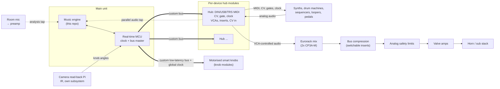

# System architecture [proposal]

Nothing here is decided. It's the current proposal, for review.

## Block diagram

Thick lines = the custom bus (two-way); thin lines = control or the analog main path; dotted = parallel taps into the engine. **No converter sits in the main path.**

## Main unit
- Runs the engine and is the bus master and the global clock.
- Candidates:
  - **Raspberry Pi CM5** on a custom carrier, with a real-time microcontroller for the bus and clock, plus an audio codec for taps.
  - **Bela** (low-latency audio on a BeagleBone-class board).
- Rejected: a USB CAN dongle (USB adds latency and jitter).
- Available today for prototyping: 4x Raspberry Pi 4 on PoE in a 19-inch rack.
- [unverified] Whether the browser-based engine runs on it as-is, or needs another runtime.

## The custom bus
- A custom low-latency protocol, not plain MIDI. **CAN-FD** is the leading candidate.
- Carries timestamped events, the global clock, knob positions and hub telemetry.
- **MIDI 2.0 (UMP) end to end on the bus**, translated to MIDI 1.0 at each hub.
- Modular isolation: a hub or knob module can fail or unplug without taking down the others. Redundancy: the analog path keeps playing if the bus stops.

## Hub modules (one per device or small group)
- **MIDI:** opto-isolated DIN in/out, isolated USB host (with 5 V power), TRS MIDI (type A/B selectable).
- **CV:** calibrated bipolar outs (at least −5 to +10 V), each storing its own gain/offset ratio. Audio-rate update is an option.
- **Gates/triggers:** +5 / +12 / +15 V and S-trig, polarity selectable.
- **Clock/sync outs:** PPQN, pulse width and polarity selectable.
- **CV inputs:** sample Eurorack outputs and envelope followers back into the engine.
- **Studio-grade audio VCAs** (THAT 2180-class as an example) on each source. They give volume, chops, ducking and sends, all timestamped to the clock.
- **Switchable compressor inserts:** click-free (VCA crossfade) routing so any of the four compressors can go anywhere, with Eurorack-to-+4 dBu level matching.
- **Specials:** an expression-jack emulator (digipot or opto-resistor, self-calibrated), isolated switch-closure outs for footswitch functions, re-amp and pedal-level outs, a line-level key-signal out.
- **Parallel audio tap** to the engine, with measured latency.
- **Hardware safety limiter** and loop-gain guard that software can't override.
- Timestamped, clock-locked event scheduling in the hub itself, so the engine can schedule ahead.

## Motorised smart knob
- A thick motorised knob (~20 mm tall, ~25 mm wide) with a thin **bezel dial** on top, the same width, on the same axis. Springs centre the bezel.
- **Nudge the bezel** and the motor drives the knob. Once it's moving, the motor follows the hand on the main knob. This replaces capacitive touch sensing.
- **Magnetic detents** at each end of the bezel's travel lock it, and the knob then spins continuously as an **LFO**.
- Works as a pot with soft end stops, or as an endless encoder. A round TFT sits stationary in the centre.
- Proposed sensing: a magnetic angle sensor (AS5600 / MT6701 class), a thin-section bearing, Hall sensing for the bezel.
- **Recall:** the knob shows the engine's current value for whatever it's mapped to, so there's never a parameter jump.
- **Mapping:** one knob selects the instrument. Mapping is adaptive and modular, from no knobs to 50+, and from no synths to 20. Essentials (drums, bass, lead, pads) map first. One parameter per dial where possible.

## Camera read-back (closing the loop on synths that can't report)
- **Phase 1, camera:**
  - 940 nm IR LED ring, Pi NoIR camera(s), a narrow 940 nm pass filter, retroreflective dots on the knob caps.
  - The LED is strobed and on/off frames are subtracted to remove stage light and lasers.
  - It runs as its **own independent subsystem on its own Pi** and keeps values live as best it can.
  - A knob hidden by a hand holds its last value and is flagged. Multiple angles reduce occlusion.
- **One 3-position control per subsystem:**
  1. **push hardware → software**
  2. **push software → hardware**
  3. **live sync**
- When the camera sees a new value on a parameter the engine is also playing, the engine **glides it in musically** rather than jumping. Parameters where a jump would be obvious (a filter, say) go on Ed's motorised knobs instead.
- Expected to cover ~80% of the need.
- **Phase 2 (optional):** per-synth sensor plates with a magnet in a replacement knob cap and an angle sensor on a thin overlay PCB, read over the bus.
- This is an unsolved gap for musicians and a product feature.

## Two-way sync
- "Push to engine" and "push to synths" (the 3-position control above).
- Sources of truth:
  - devices that transmit changes (MX-1, LinnStrument, Volante, midiphy);
  - SysEx dumps (RD-8, TD-3 patterns);
  - camera read-back;
  - the hub's own VCAs and CV, which the system owns outright.

## Capture and escape
- The engine sends MIDI to the sequencers and loopers (MBSEQ, LoopA, SQUID).
- **Capture:** take a machine phrase and play over it.
- **Escape:** hand back to the machine.
- The open-source midiphy firmware is where capture/escape can live inside the device itself.

## Room mic
- An Audio-Technica mic into an AudioScape V1290, tapped into the engine.
- Uses:
  - room analysis;
  - the system's live ear (there are no monitors);
  - deliberate, guarded feedback and distortion.

## Build roadmap (layers; each one works without the next)
1. **Volumes from the desk.** Hub VCAs (or Eurorack VCAs on hub CV) on every source, plus MIDI CC where devices support it (MX-1, Volante). Start logging every event with timestamps.
2. **Main unit and bus.** The main unit, the custom bus, the global clock, hubs with isolated MIDI/USB/TRS, CV/gates/clock and switchable inserts.
3. **Motorised smart knobs.** Recall, adaptive mapping, the instrument-select knob.
4. **Camera read-back.** The IR subsystem with the 3-mode sync.
5. **Room mic, capture/escape, MIDI 2.0.** Analysis taps, capture/escape in the sequencers, MIDI 2.0 end to end on the bus.
6. Later: the power layer, and the speculative concepts in ideas.md.

## Product note
The hardware (smart knobs, hubs, camera read-back) is meant to become a product. The engine remains Ed's own software.
